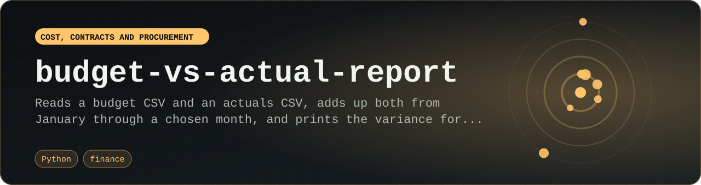
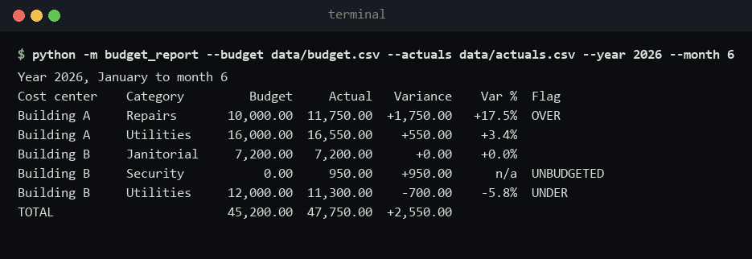

<p align="center"></p>

# budget-vs-actual-report

[](https://github.com/yassine2med/budget-vs-actual-report/actions/workflows/ci.yml)  

Comparing a budget with real spending is a monthly chore that usually lives in a spreadsheet. This repo reads a budget CSV and an actuals CSV, adds up both from January through a chosen month, and prints the variance for each cost center and category with a flag where spending is out of line.



## What it is for

Facility and property managers track repairs, utilities and services against a yearly budget. This tool answers one question quickly: where are we over, under, or spending money nobody budgeted? It works from two plain CSV files, so it fits most accounting exports, and it can save the result to a CSV for a monthly review.

## Install

```
git clone https://github.com/yassine2med/budget-vs-actual-report
cd budget-vs-actual-report && pip install -r requirements.txt
```

## How to use

| I want to | Command |
|---|---|
| See every cost center and category through June | `PYTHONPATH=src python -m budget_report --budget data/budget.csv --actuals data/actuals.csv --year 2026 --month 6` |
| Roll categories up to one row per cost center | `PYTHONPATH=src python -m budget_report --budget data/budget.csv --actuals data/actuals.csv --month 6 --by-cost-center` |
| Show only the flagged rows | `PYTHONPATH=src python -m budget_report --budget data/budget.csv --actuals data/actuals.csv --month 6 --flagged` |
| Change the flag threshold in percent (default 5) | `PYTHONPATH=src python -m budget_report --budget data/budget.csv --actuals data/actuals.csv --month 6 --threshold 10` |
| Also save the rows to a CSV file | `PYTHONPATH=src python -m budget_report --budget data/budget.csv --actuals data/actuals.csv --month 6 --csv report.csv` |
| Show help | `PYTHONPATH=src python -m budget_report --help` |

The report prints a table and exits with code 0. Bad input (missing column, bad date, text where a number belongs) prints an error and exits with code 1. Defaults: year 2026, month 12.

Example:

```
PYTHONPATH=src python -m budget_report --budget data/budget.csv --actuals data/actuals.csv --year 2026 --month 6
```

Output:

```
Year 2026, January to month 6
Cost center    Category         Budget     Actual   Variance    Var %  Flag
Building A     Repairs       10,000.00  11,750.00  +1,750.00   +17.5%  OVER
Building A     Utilities     16,000.00  16,550.00    +550.00    +3.4%
Building B     Janitorial     7,200.00   7,200.00      +0.00    +0.0%
Building B     Security           0.00     950.00    +950.00      n/a  UNBUDGETED
Building B     Utilities     12,000.00  11,300.00    -700.00    -5.8%  UNDER
TOTAL                        45,200.00  47,750.00  +2,550.00
```

Run the tests with `python -m pytest -q`.

## How it works

1. Budget rows (cost_center, category, month, amount) for months 1 up to the chosen month are summed per cost center and category.
2. Actual rows (date, cost_center, category, amount) dated in the chosen year and up to the chosen month are summed the same way.
3. Variance is actual minus budget, and variance percent is that figure as a share of budget. A positive number means overspent.
4. A row is flagged OVER when spending is above budget by more than the threshold, UNDER when it is below by more than the threshold, and UNBUDGETED when money was spent where nothing was budgeted.
5. `--by-cost-center` adds the categories together and applies the OVER flag to each cost center total.

## Limits

- CSV input only, one currency, no conversion.
- Budget is by month number and actuals are by calendar date, so the report covers one calendar year at a time, from January.
- With `--by-cost-center` only OVER is flagged, not UNDER or UNBUDGETED.
- It compares totals; it cannot tell you why a line went over.

## License

MIT. Yassine Emhamed, 2026.
